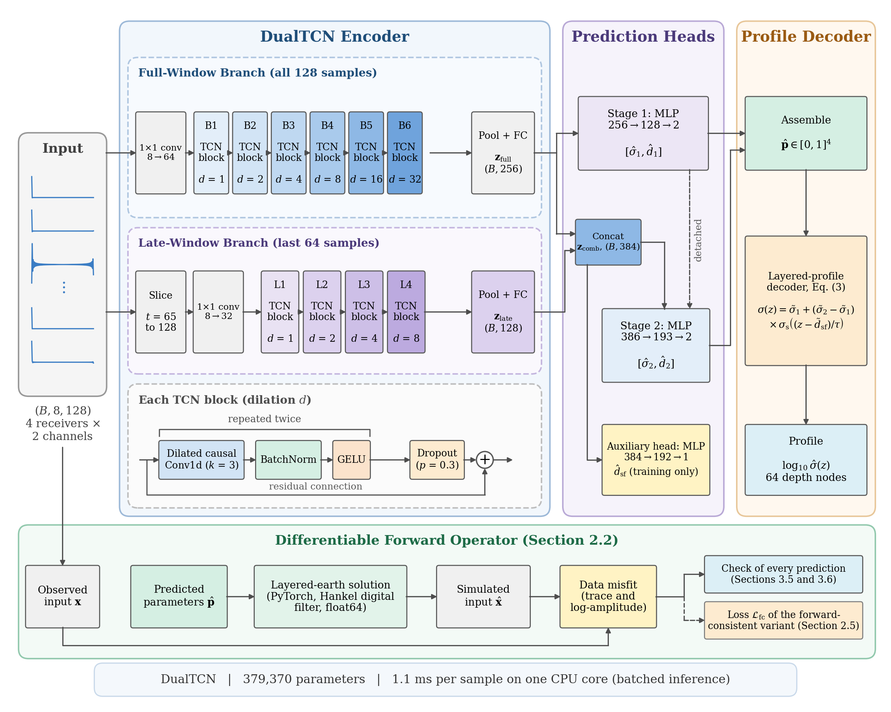

# DualTCN: deep learning inversion of time-domain marine CSEM data with a differentiable forward operator

**Khaled Ahmed and Ghada Omar**, Southern Illinois University Carbondale

This repository contains the code, the trained networks, and a sample dataset for the revised paper
(Environmental Modelling & Software, revision 1). The code of the original submission is kept in the
same repository; the files of the revision are listed below. The main network of the revised paper is
`rn_noprof_s*` (supervised, noise on the raw transients, no profile loss; Section 3.1).



*Figure 2 of the revised paper. A full-window branch and a late-window branch encode the band-limited traces, two-stage heads
predict the four parameters, and a layered-profile decoder converts them into a conductivity profile for display. The
differentiable forward operator (bottom strip) simulates the input of the predicted parameters; its data misfit checks
every prediction and, in the forward-consistent variant only, serves as a training loss.*

## What is in the revision

- `src/forward_torch.py`: the one-dimensional marine CSEM forward operator (horizontal electric dipole,
  air / seawater / seafloor half-space) in PyTorch, in double precision, with exact gradients. It
  reproduces `empymod` (Key 201-point digital filter) to a relative error of 2.8e-13 in the frequency
  domain on 2,000 random models (`src/validate_forward_torch.py`, `results/step1_forward_torch/`).
- `src/config_v6.py`, `src/generate_torch_dataset.py`: the corrected data generator (exact Fourier grid
  f_k = k/32 Hz, no source-motion factor). It generates the one million samples of the paper in about
  three minutes on one A100 GPU.
- `src/train_v6.py`: training of the supervised and the forward-consistent networks, with noise on the
  raw transients (`--raw-noise`) or on the normalized traces only, and batch-normalization
  recalibration before every evaluation.
- `scripts/analysis/`: the analyses of the paper (sensitivity, noise robustness and uncertainty,
  shifted distributions, three-layer test, comparison with conventional inversion, timing).
- `scripts/figures/`: the figures of the paper, with one common style file (`dualtcn.mplstyle`).
- `scripts/field_al611/`, `src/field_al611/`: the forward fit of the public AL611 field data
  (PANGAEA, doi:10.1594/PANGAEA.989421), which must be downloaded separately.

## Installation

```bash
git clone https://github.com/Kahmed68/DualTCN.git
cd DualTCN
pip install -r requirements.txt      # Python 3.10+, PyTorch 2.x, NumPy, SciPy, empymod, matplotlib
```

## Quick test with the sample dataset (under a minute on one GPU, about six minutes on an 8-core CPU)

Download `sample_v6_5000.npz` from the release assets (the first 5,000 samples of the full dataset) and run

```bash
PYTHONPATH=src python src/train_v6.py --data sample_v6_5000.npz --out runs/quick --seed 1 --epochs 3 \
  --misfit-w 1 --amp-w 0.1 --misfit-start 1 --misfit-ramp 1 --misfit-sub 64 --val-misfit-n 750 --raw-noise
```

## Reproducing the paper

1. Generate the one million samples (seed 42):

   ```bash
   PYTHONPATH=src python src/generate_torch_dataset.py --n 1000000 --out data/mcsem_dataset_v6.npz --device cuda
   ```

   A regeneration on another A100 node gave arrays that are bit-identical to those of the paper. The file
   checksum still differs, because the `meta` field records the generation time.

2. Train the four conditions of Table 3 with seeds 1, 2, and 3 (100 epochs; 1.2 GPU-hours for the
   supervised and 4.35 GPU-hours for the forward-consistent network on one A100):

   ```bash
   # supervised (W=0) or forward-consistent (W=1); add --raw-noise for the noise on the raw transients
   PYTHONPATH=src python src/train_v6.py --data data/mcsem_dataset_v6.npz --out runs/rn_mis_s1 --seed 1 \
     --epochs 100 --misfit-w 1 --amp-w 0.1 --misfit-start 5 --misfit-ramp 10 --misfit-sub 64 \
     --val-misfit-n 20000 --raw-noise
   ```

   The ablations add options to these commands: `--profile-w 0` removes the profile loss (Section 3.1;
   runs `noprof_s*` with the original noise, `rn_noprof_s*` and `rn_misnp_s*` with `--raw-noise`), and
   `--arch dualtcn_nolate` removes the late-window branch (Section 3.1; runs `rn_nolate_s*`, supervised,
   `--raw-noise`, with the profile loss, and `rn_nolatenp_s*`, the same with `--profile-w 0`).
   Each run writes `best.pt`, `log.csv`, and `test_metrics.json` to its output folder.

3. Evaluate the released networks (or your own runs) on the test split and print Table 3:

   ```bash
   PYTHONPATH=src python scripts/evaluate_release.py --data data/mcsem_dataset_v6.npz --weights weights
   ```

   The script also compares every network with its stored `test_metrics.json`. It takes about 1 min per
   network on one GPU (add `--no-misfit` to skip the data-misfit columns on a CPU).

## Commands for each table and figure

Download and unpack `weights_r1.tar.gz` from the release into the repository root, generate the dataset
(step 1 above), and set two environment variables, so that the scripts read the dataset from `data/` and
write their results to `results/` instead of the folders of our cluster:

```bash
export PYTHONPATH=src DUALTCN_DATA=data/mcsem_dataset_v6.npz DUALTCN_RUNS=results
```

| Paper item | Command | Output in `results/analysis/` |
|---|---|---|
| Table 3 (Sect. 3.1) | `python scripts/evaluate_release.py --data $DUALTCN_DATA --weights weights` | printed |
| Sect. 3.2, sensitivity | `python scripts/analysis/j1_sensitivity.py --n 2000 --n-check 10` | `j1/` |
| Sect. 3.2 and 3.9, longer offsets | `python scripts/analysis/j1_offsets.py` (after `j1_sensitivity.py`) | `j1_offsets/` |
| Fig. 3, linearized estimate | `python scripts/analysis/j1_snr.py` (after `j1_sensitivity.py`) | `j1/j1_snr.json` |
| Fig. 3, Table 4, Supp. Tables S14 to S18 (Sects. 3.3, 3.4), main network | `python scripts/analysis/n1_u1_noise_uq.py --root weights --runs rn_noprof_s1,rn_noprof_s2,rn_noprof_s3 --tag rn_noprof` | `n1_u1/` |
| Fig. 3 and Supp. Table S14, other networks | the same with `--runs noprof_s1,noprof_s2,noprof_s3 --tag noprof`, `--runs rn_base_s1,rn_base_s2,rn_base_s3 --tag rn_base_tm`, and `--runs rn_misnp_s1,rn_misnp_s2,rn_misnp_s3 --tag rn_misnp` | `n1_u1/` |
| Supp. Tables S15 to S18 (LaTeX) | `python scripts/figures/tab_supp_uq.py results/analysis/n1_u1/n1_u1_rn_noprof.json` | printed |
| Supp. Table S14 (LaTeX) | `python scripts/figures/tab_supp_noise.py` (after the four runs above) | printed |
| Fig. 3 (plot) | `python scripts/figures/fig_noise.py figures/` | `figures/fig3_noise.png` |
| Sect. 3.5, shifted distributions | `python scripts/analysis/o1_shift.py --root weights --runs rn_noprof_s1,rn_noprof_s2,rn_noprof_s3 --tag rn_noprof` (and `rn_misnp_s*`, `--tag rn_misnp`) | `o1/` |
| Sect. 3.6, three-layer models | `python scripts/analysis/o2_threelayer.py --root weights --runs rn_noprof_s1,rn_noprof_s2,rn_noprof_s3 --n 5000 --tag rn_noprof` (and `rn_misnp_s*`, `--tag rn_misnp`) | `o2/` |
| Table 5, conventional methods without warm start, clean data (Sect. 3.7) | `python scripts/analysis/c1_conventional.py --n 200 --net-run weights/rn_base_s1 --out results/analysis/c1/full_n200_rn` | `c1/full_n200_rn/` |
| Table 5, the same at 40 dB | the same with `--snr 40 --noise-seed 4040 --out results/analysis/c1/full_n200_rn_snr40` | `c1/full_n200_rn_snr40/` |
| Table 5, 40 dB with the selected damping | `NET=weights/rn_base_s1 bash scripts/analysis/c1_reg_chain.sh` | `c1/full_n200_rn_snr40_reg/` |
| Table 5, DualTCN rows and warm starts from the main network | `python scripts/analysis/c1_conventional.py --n 200 --methods WS-LM,WS-LBFGSB --net-run weights/rn_noprof_s1 --out results/analysis/c1/noprof_n200_rn`, the same with `--snr 40 --noise-seed 4040` (`noprof_n200_rn_snr40`), and with `--snr 40 --noise-seed 4040 --methods WS-LM --lam 1e-3` (`noprof_n200_rn_snr40_reg`) | `c1/noprof_n200_rn*/` |
| Table 5 and Table 6, computing times | the three Table 5 runs with the main network (all methods: `--net-run weights/rn_noprof_s1`, clean, `--snr 40 --noise-seed 4040`, and `--snr 40 --noise-seed 4040 --methods LM,WS-LM --lam 1e-3`) with `--workers 32`; the paper's times were measured with 33 cores of a shared CPU node (AMD EPYC 7763), and absolute times change by a factor of about 3 with the load of the node | `c1_timing/` |
| Table 6, inference time | printed by `c1_conventional.py` (`dualtcn_cpu_ms_per_sample` in `c1_summary.json`) | `c1/` |
| Table 6, training time | column `sec_train` of `log.csv` written by `src/train_v6.py` | run folder |
| Introduction, operator timing | `python scripts/analysis/time_forward_torch.py` (GPU) | `time_forward_torch.json` |
| Figs. 1 and 2 | `python scripts/figures/fig_schematics.py figures/` (Fig. 2 draws traces of `data/sample_v6_5000.npz`) | `figures/` |
| Sect. 2.2, Supp. Sect. S12.8 and Table S9 (time content of the traces) | `python scripts/analysis/n1_time_axis.py` (CPU, a few minutes) | `n1_time_axis.json` |
| Sect. 2.2, Supp. Sect. S20 and Table S19 (time-gated step-off records) | `python scripts/analysis/td_conversion.py --root weights --runs rn_noprof_s1,rn_noprof_s2,rn_noprof_s3 --out results/analysis/td_conversion_noprof` (GPU recommended) | `td_conversion_noprof/` |
| All numbers quoted in the revised text | `python scripts/analysis/opt1_numbers.py` (after the analyses above) | printed |
| Supp. Fig. S5 (convergence) | `python scripts/figures/fig_convergence.py figures/` (after the three Table 5 runs) | `figures/` |
| Supp. Sect. S12.7, operator validation | `python src/validate_forward_torch.py` and `python src/compare_v4_v6.py` | `results/step1_forward_torch/` |
| Supp. Sect. S13.4, Fig. S3 (AL611 field data) | `scripts/field_al611/g3_validate.py`, `g2_lm_torch.py`, `p8_fit_figure.py` (download the AL611 files from PANGAEA first, doi:10.1594/PANGAEA.989421) | `al611/` |

The conventional inversions run on CPU cores (`--workers` sets the number of processes); the 200 clean
samples took about 45 min with 8 workers. Without the environment variables, the scripts use the folders
of our cluster as defaults. Supplementary tables marked as computed on the original data generator come
from the code of the original submission, which is kept in this repository (`src/train_p9d.py` and the
`*_v4.py` files), and the original weights in `weights/best_model_p9d*.pt` are Git LFS files: install
Git LFS (`git lfs pull`) to download them.

## Trained networks

The release assets contain `weights/<condition>_s<seed>/best.pt` (PyTorch state dict of
`src/model_p9d.py:LateTimePCRN`, 379,370 parameters; `rn_nolate_s*` and `rn_nolatenp_s*`: `src/model_ablation.py:NoLatePCRN`), with `args.json` and `test_metrics.json` of each run:

| Folder | Training noise | Loss |
|---|---|---|
| `base_s*` | normalized traces only | supervised |
| `mis_s*` | normalized traces only | forward-consistent |
| `rn_base_s*` | raw transients | supervised |
| `rn_mis_s*` | raw transients | forward-consistent |
| `noprof_s*` | normalized traces only | supervised, no profile loss (decoder ablation) |
| `rn_noprof_s*` | raw transients | supervised, no profile loss (**main network**) |
| `rn_misnp_s*` | raw transients | forward-consistent, no profile loss |
| `rn_nolate_s*` | raw transients | supervised, with the profile loss, without the late-window branch (`--arch dualtcn_nolate`) |
| `rn_nolatenp_s*` | raw transients | supervised, no profile loss, without the late-window branch |

The saved batch-normalization statistics are the recalibrated ones, so the networks can be evaluated directly.
`SHA256SUMS` lists the checksums of all release files.

## Citation

Please cite the paper and release v1.3-r1 of this repository (see `CITATION.cff`).

## License

MIT (see `LICENSE`).
